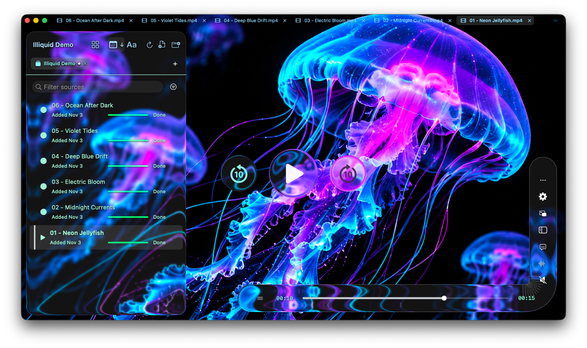

# Illiquid

A native macOS media player for your videos.

Illiquid puts your videos at the center of an interface that moves with you.
Browse your folders without leaving the player, arrange the playback controls
around your video, and find your place with a visual timeline.

- **A flexible timeline.** Move and reshape the playback bar, preview moments,
  and seek precisely without leaving the video.
- **Your library alongside playback.** Browse, filter, and organize local
  sources in the sidebar, with tabs for quick switching.
- **A player that remembers.** Track progress and resume videos where you
  left off.
- **Made for macOS.** Enjoy Picture in Picture, HDR, media keys, and a resizable
  interface, with audio and subtitle controls close at hand.

## Performance

Illiquid uses FFmpeg and Apple's VideoToolbox for video decoding, with native
macOS rendering and hardware acceleration when available. Its playback pipeline
uses bounded queues to manage buffered media during playback.

## Download

Get Illiquid from [GitHub Releases](https://github.com/Jagalite/illiquid/releases).
Requires an Apple Silicon Mac running macOS 26 or later.

Current releases are ad hoc signed and unnotarized prereleases, so macOS may
block downloaded copies.

## License

Illiquid is licensed under [GPL-3.0-or-later](LICENSE). See
[third-party notices](THIRD_PARTY_NOTICES.md) for dependency licenses.
